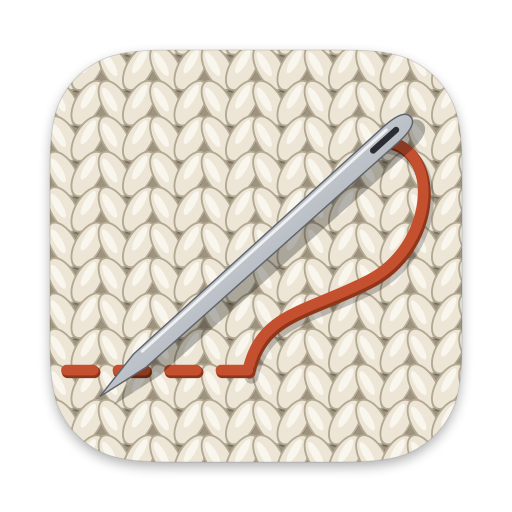
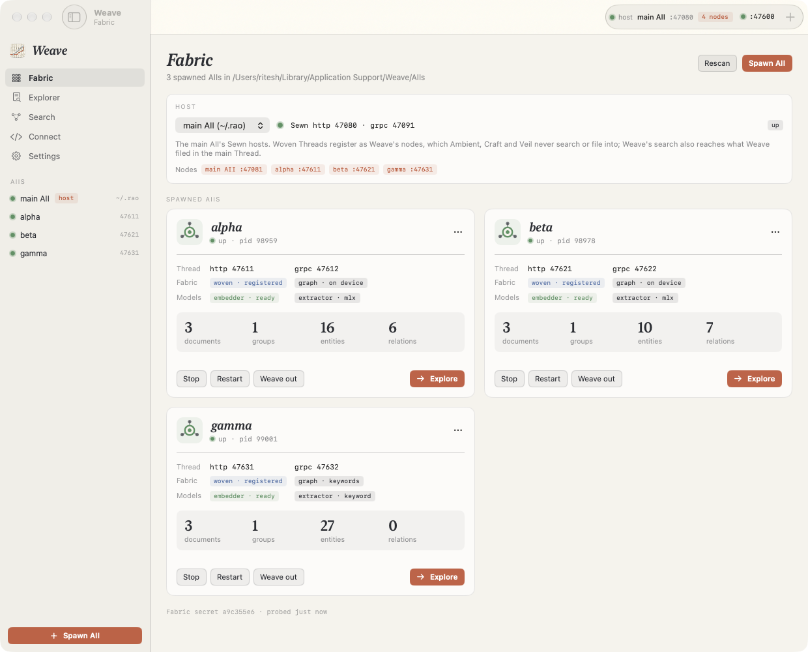
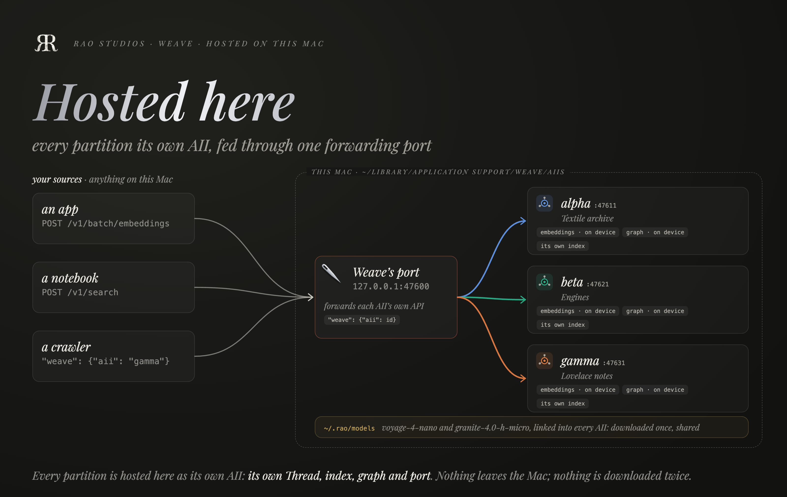
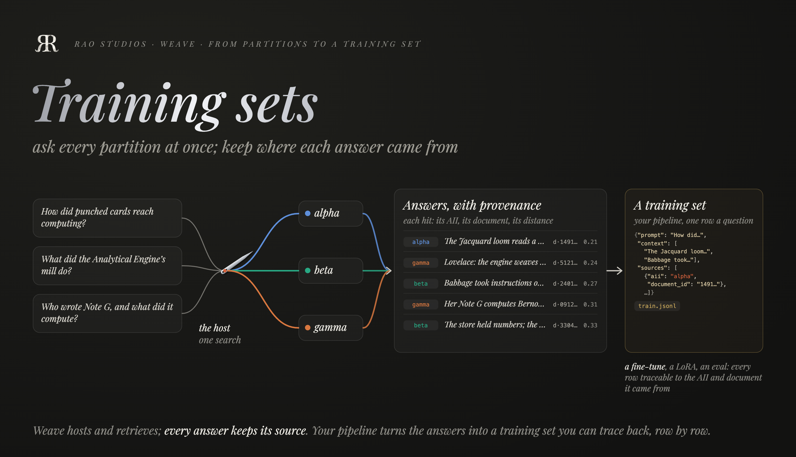
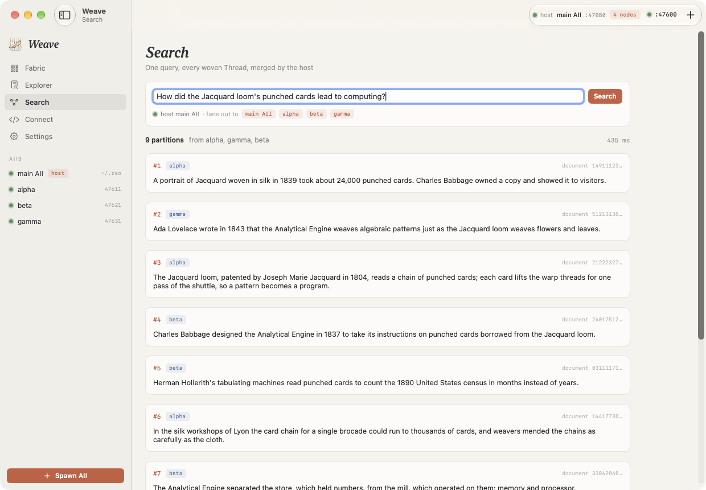
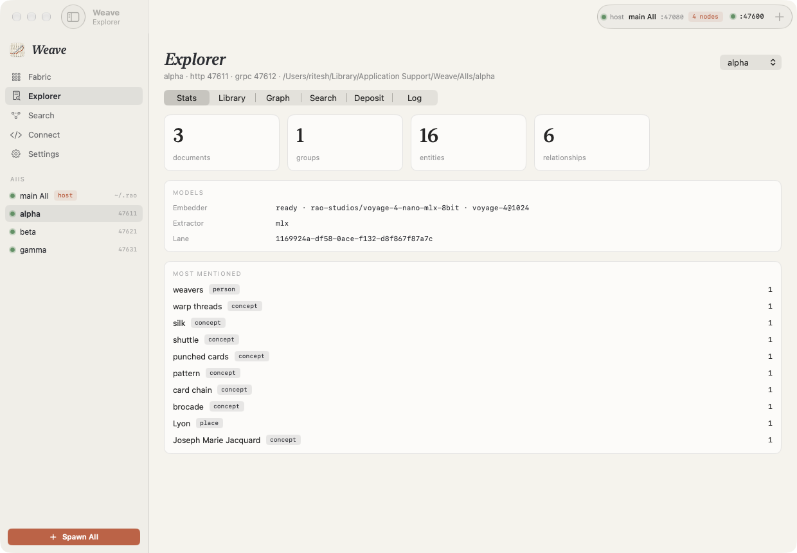
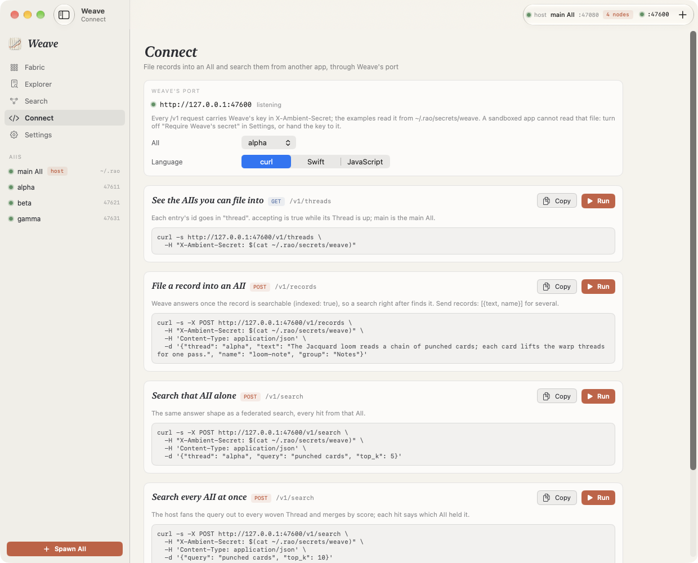

[![Weave, by Rao Studios: spawn AIIs, and search every Thread as one. On a warm black plate, the title Weave in silver italic. Below it, three coloured threads start at the left, at three Threads, alpha on 47611, beta on 47621 and gamma on 47631, and sweep right into the eye of a steel needle leaning 45 degrees down to the right, the host, level with the middle strand and just past the subtitle's last word; the needle writes them onto a small patchwork quilt in their colours, laid in perspective like cloth on a table, labelled your query on Weave's port, 47600: every partition, merged by score. The legend reads: host, a Sewn; alpha, beta, gamma, Threads.](Docs/README_Assets/hero.png)](Docs/README_Assets/hero.png)

# Weave



Spawn AIIs on demand, and search every Thread as one.

Weave is a macOS app in the Rao Studios line. It spawns AIIs, each a full Ambient Intelligence Index home with its own Thread on its own ports. Each one takes deposits directly, embeds them on device with voyage-4-nano, and extracts their graph on device with Granite 4.0 H-Micro. The models already downloaded in `~/.rao` are shared, so a spawned AII downloads nothing.

Choose one AII as the host: the main AII in `~/.rao`, or one Weave spawned. Every woven Thread registers with the host's Sewn, and one query to the host fans out to all of them and merges their partitions by score. That is federated retrieval across data partitions, in its plainest form. Weave also opens a port of its own, so any local process can ask that question too.

<br clear="left">

<p align="center"></p>

<p align="center"><em>Three AIIs spawned and managed: each on its own port slot, each woven into the host.</em></p>

## Why Weave

Weave hosts data locally, partitioned. Each body of knowledge gets its own AII on this Mac: its own Thread, index, graph and port. Your apps, notebooks and crawlers fill them through one port, in each AII's own API. Nothing leaves the Mac, and the models are downloaded once and shared.

<p align="center"></p>

That makes the partitions a source for training data. Ask every partition at once through the host, and each answer comes back with the AII and the document it came from. Your pipeline turns those answers into rows of a training set, for a fine-tune, a LoRA or an eval, and every row can be traced back to its source.

<p align="center"></p>

The plates are rebuilt by `Docs/README_Assets/src/build.sh hosting datasets`.

## How it fits the Ambient Intelligence Index

| | HTTP | gRPC | What it is |
| --- | --- | --- | --- |
| Main AII Sewn | 47080 | 47091 | The Sewn every Rao app shares (`~/.rao`) |
| Main AII Thread | 47081 | 47090 | The index every Rao app shares |
| Weave | 47600 | | Weave's own port: `/health`, `/v1/threads`, `/v1/search` |
| Spawned AII *n* | 47600 + 10*n* + 1 | + 2 | Its Thread |
| Spawned AII *n*, as host | + 3 | + 4 | Its Sewn, started only while it hosts |

Weave is a command center apart from `~/.rao`. Each spawned AII is a full AII home in Weave's own folder, `~/Library/Application Support/Weave/AIIs`, and its models are a link to `~/.rao`'s, so nothing downloads twice. Weave's footprint in `~/.rao` is what every Rao app has there: its secret and its lane. To keep the AIIs elsewhere, such as an external drive, turn on *Custom location* in Settings › Storage and choose a folder. The custom location is never the default. Weave remembers the folder while the toggle is off, and won't create it if its drive isn't connected. Any drive works. An ExFAT drive can't hold an AII's secrets or device key, because it has no hard links and no permissions. On one, each AII's index and graph go to the drive, while its secrets, keys and settings stay in Weave's folder on this Mac. Weave runs the AII build installed at `~/.rao/aii/bin/AIIServer` and never builds one.

**Storage.** Settings › Storage shows how much the AIIs hold on disk. *Remove All AIIs…* stops and deletes every one. *Remove Weave from This Mac…* also deletes Weave's folder, removes only what Weave made in a custom location, and takes its secret and lane out of `~/.rao`, then quits; drag Weave to the Trash after. macOS keeps an app's folder in Application Support when the app alone goes to the Trash, so this is the step that frees the space.

**The fabric.** Weave registers itself in the main AII as the `weave` app. A spawned home is seeded before AII provisions it: its stack secret is Weave's secret in `~/.rao`, and its device key is a copy of the main one, so its lane ids match the main AII's. When the main AII hosts, the main Sewn sees Weave's Threads as Weave's nodes. Ambient, Craft and Veil never search or file into those nodes. When a spawned AII hosts, every peer registers with it as that home's own stack.

**The owner.** A deposit reaches a federated search only when it is filed as `local-weave`, the owner Weave's lane answers for. Weave's deposit pane always files that way, and `/v1/threads` says so.

## Build and run

Requirements: macOS 26 on Apple silicon, Swift 6.2 or later, and an installed AII build that grants `POST /v1/search` to a local app with no account. That grant is one line in the AII repository's `Sources/Sewn/API/Middleware/LocalOnlyGrant.swift`. Install it from the checkout:

```sh
aii install ~/Documents/rao/repositories/AII && aii restart
```

Then:

```sh
swift build                       # the app and WeaveKit
swift test                        # Ops, seeding on scratch AII homes, the port, the services
./Scripts/dev/dev.sh              # build, stable-sign and run
./Scripts/dev/dev.sh --self-test  # headless: a scratch AII home, a spawn, the port; exits 0/1
./Scripts/build/make-app.sh       # build/Weave.app, icon compiled, signed
```

`Weave --e2e <folder>` runs the whole fabric against this Mac's real AII, then removes what it made. It spawns two AIIs, deposits into each, searches through the main AII and through Weave's port, makes one AII the host, and searches again.

## Using it

- **Spawn.** ⌘N names an AII and picks how it reads a graph: on device, or keywords only. Weave finds a free port slot, provisions the home in its own folder, links the models, and starts its Thread woven into the host.
- **Weave in, weave out.** A woven Thread registers with the host. A loose one runs standalone and only takes direct deposits. Switching restarts the Thread, since a Thread reads its mothership at launch.
- **The host.** Choose it on the Fabric page. Weave brings the host's Sewn up and moves every running woven Thread onto it. The main AII is held with a lease, as every Rao app holds it.
- **Explore.** Any Thread, in Weave's lane: its counts and models, its library, its graph, a search of it alone, a deposit into it, and its log.
- **Search.** One query to the host. Each merged hit is named by the AII whose Thread answered it.
- **Connect.** Each AII's own requests through Weave's port, with the routing spec, in curl, Swift or JavaScript, with each one's direct form, Copy and Run. An AII card's "…" menu opens it on that AII.
- **Quit.** Weave's port closes and its lease goes. Spawned Threads keep running and are adopted at the next launch, unless Settings say to stop them.

## In the window

<p align="center"></p>

<p align="center"><em>One question to the host. The answers come from all three Threads, each labelled with the AII that held it.</em></p>

<p align="center"></p>

<p align="center"><em>One Thread explored: what alpha holds, and the graph it extracted on device as the notes came in.</em></p>

The README's screenshots are rebuilt by `Scripts/art/readme-shots.sh`, which seeds a demo fabric (`Weave --demo seed`), captures each page, and removes it. `Weave --e2e <folder>` runs the Connect page's curl, Swift and JavaScript examples against a real fabric as another app would, and sends one of them straight to the Thread, without Weave, to check the direct form answers the same.

## Connect another app

Weave's port, `127.0.0.1:47600`, forwards rather than defines. A request is exactly what an AII's Thread takes, on the same path, plus one object Weave reads and strips, the routing spec:

```json
"weave": {"aii": "alpha", "wait": true}
```

| Key | Means |
| --- | --- |
| `aii` | Which AII's Thread gets the request: an id from `GET /v1/threads`. `main` is the main AII. The `X-Weave-AII` header or `?aii=` work too. |
| `wait` | On `POST /v1/batch/embeddings`: answer once every input is searchable, so a search right after finds it. |

Weave adds that AII's key and, where a body leaves it out, the owner `local-weave`, which a search across every AII answers for. It answers with the Thread's own status and body. On success the body gains a `weave` object saying what Weave did. To port a request to the Thread directly later, drop `weave` and send the same body to the Thread's own URL with its key. `GET /v1/threads` lists both, as each AII's `direct.url` and `direct.key_file`.

| Weave's port | Goes to |
| --- | --- |
| `GET /health`, `GET /v1/threads` | Weave's own: its health, and the AIIs a request can route to |
| `POST /v1/batch/embeddings`, `/v1/search`, `/v1/library`, `/v1/graph`, `GET /v1/stats` | That AII's Thread, the same route and body |
| `POST /v1/search` with no `aii` | The host's Sewn, in Sewn's own body, a search across every woven AII; `weave.threads` names the AII behind each `thread_id` |

**Connect** in the sidebar shows each request below in curl, Swift or JavaScript, ready to copy. Each card also shows its direct form for the AII you pick. The page offers a thin client to paste in as your network service, and **Run** sends any request so you see its answer first.

<p align="center"></p>

**See the AIIs a request can route to.**

```sh
curl -s http://127.0.0.1:47600/v1/threads -H "X-Ambient-Secret: $(cat ~/.rao/secrets/weave)"
```

```json
{"threads": [{"id": "alpha", "label": "alpha", "status": "up", "accepting": true,
              "direct": {"url": "http://127.0.0.1:47611", "key_file": "~/Library/Application Support/Weave/AIIs/alpha/secrets/weave"}, …},
             {"id": "main", "label": "main AII", …}],
 "routing": "\"weave\": {\"aii\": id, \"wait\": true}  (or X-Weave-AII: id, or ?aii=id)", …}
```

**File records into one.** This is Thread's own insert body. `entities`, `relationships`, `tags`, `metadata` and `media_type` pass through untouched. Entities you name are in the graph at once, and a search that matches an entity looks among the records that carry it. The on-device extractor adds more entities as it reads.

```sh
curl -s -X POST http://127.0.0.1:47600/v1/batch/embeddings \
  -H "X-Ambient-Secret: $(cat ~/.rao/secrets/weave)" -H 'Content-Type: application/json' \
  -d '{"weave": {"aii": "alpha", "wait": true},
       "inputs": ["The Jacquard loom reads a chain of punched cards."], "names": ["loom-note"], "sanitize": true,
       "thread": {"owner_id": "local-weave", "group": {"id": "notes", "label": "Notes", "owner_id": "local-weave"}},
       "entities": [[{"name": "Jacquard loom", "kind": "machine"}, {"name": "punched cards", "kind": "concept"}]]}'
```

**Search it.** This is Thread's own search body, routed to one AII:

```sh
curl -s -X POST http://127.0.0.1:47600/v1/search \
  -H "X-Ambient-Secret: $(cat ~/.rao/secrets/weave)" -H 'Content-Type: application/json' \
  -d '{"weave": {"aii": "alpha"}, "query": "punched cards", "thread": {"owner_id": "local-weave", "scope": "global", "top_k": 5}}'
```

To search every woven AII at once, leave out `weave` and send Sewn's own search body: `{"query": "punched cards", "top_k": 10, "sewn": {"owner_id": "local-weave", "scope": "global"}}`.

| Answer | Means |
| --- | --- |
| The Thread's own | Whatever the AII answered, passed through |
| 400 | No `aii` for a Thread route, or a body that isn't a JSON object |
| 401 | Missing or wrong `X-Ambient-Secret` |
| 404 | No AII with that id: `GET /v1/threads` lists them |
| 502 | The AII's Thread is stopped: start it in Weave |
| 503 | No host is up, for a search across every AII |

**The key.** The examples read Weave's key from `~/.rao/secrets/weave`. A sandboxed app can't read that file: turn off *Require Weave's secret* in Settings, or hand the key to the app. The port binds 127.0.0.1 and refuses any request whose Host isn't this Mac. `GET /health` is always open.

## Layout

Weave is built on [Granite](https://github.com/riteshpakala/Granite). Each subsystem is a service with one synchronous writer. Work runs in reducer effects, and replies come back as tickets. Each page is a component.

| Target | What it holds |
| --- | --- |
| `WeaveKit` | The services, the fabric's homes, ports and launch specs over AII's contract, the loopback clients for Thread and Sewn, and Weave's port (Hummingbird) |
| `Weave` | The app: the shell and settings services, the pages, the design, and `WeaveAppRoot`, the façade AppKit calls |

| Service | Responsible for |
| --- | --- |
| `FabricService` | The spawned homes and their Thread processes: scan, spawn, start, stop, weave, remove, and the probe loop |
| `HostService` | The host's Sewn: bringing it up, re-weaving the Threads onto it, and the nodes it sees |
| `SearchService` | The federated query, each hit named by instance |
| `PortService` | Weave's own port on 127.0.0.1 |
| `ExplorerService` | One Thread's stats, library, graph, search, deposits and log |
| `ConnectService` | The Connect page's examples: the AII and language they use, and each one run against Weave's port |
| `SettingsService`, `ShellService` | The app's preferences (`weave.settings.0002`) and its window |

The relays point down only: Search → Host → Fabric, Port → Host and Fabric, Explorer → Fabric.

## Scripts

| Script | Does |
| --- | --- |
| `Scripts/dev/dev.sh` | Build, stable-sign and run |
| `Scripts/build/make-app.sh [--install]` | Assemble, stamp and sign `build/Weave.app` |
| `Scripts/art/gen-app-icon.swift` | Render the app icon (knitted cloth, a needle, a vermilion thread) from its SVG |
| `Scripts/art/readme-shots.sh` | Rebuild the README's screenshots from a demo fabric |
| `Docs/README_Assets/src/build.sh` | Rebuild this README's hero |

GNU General Public License v3.0 (see [LICENSE](LICENSE)).

> *Every thread its own; one cloth when you ask.*
